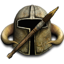

# Savage Minimap Maker

Make and edit minimaps (`mapname_overhead.jpg`) for **Savage DRX** maps, right in your browser. Nothing to install.

**Use it here:** https://SavageDRX.github.io/savage-minimap-maker/

## What it does

- **Open a map:** drop in a `.s2z` file. The playable area, walls and objects are worked out automatically.
- **Style it:** 18 ready-made styles based on the game's own minimaps, or pick your own colours and textures. You can also upload your own texture images.
- **Edit it:** paint terrain and walls with round or square brushes, and move, resize, rotate, recolour, copy and paste icons. There's also a grid, a mirror copy for fair two-team maps, and undo and redo.
- **Icons:** redstone and gold mines, autominers, flags, trees, bridges, waterfalls, sawmills, infirmaries, Grimm's walls, creatures and more. You can also upload your own icons.
- **Export:** download `mapname_overhead.jpg`, ready to drop next to your map.
- **Make a playable map:** draw a layout, place mines and flags, and download a real `.s2z` for the Savage editor.
- **Your work is kept:** it autosaves in your browser and reopens your last project. Save project files to carry on later.

## Using your minimap in the game

1. Load your map's `.s2z` and style it.
2. Press **Download overhead .jpg**.
3. Put `mapname_overhead.jpg` next to `mapname.s2z` in your Savage `game/world` folder.

## Turning a drawing into a map

1. Start blank, paint walls with the **Background** brush, and place mines, flags and trees.
2. Open **Make a playable map** and press **Download playable map**.
3. Unzip it into `Savage/Graveyard/World`, start the editor (`editor.bat`), and type `world mapname` in the console.
4. Add the two command centres if you started blank, then save with `writeworld mapname`.

## Privacy

Everything runs in your browser. Map files, pictures and projects never leave your computer.

## Running it yourself

It's a single file. Download `index.html` and open it in Chrome, Edge or Firefox, or host it on any web server.
